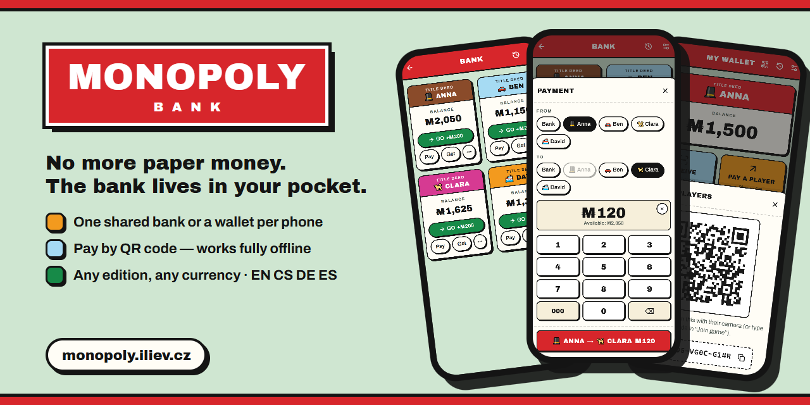
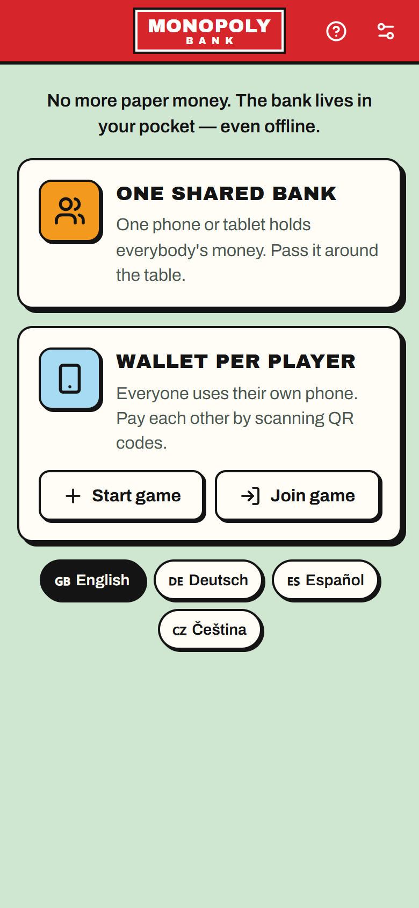
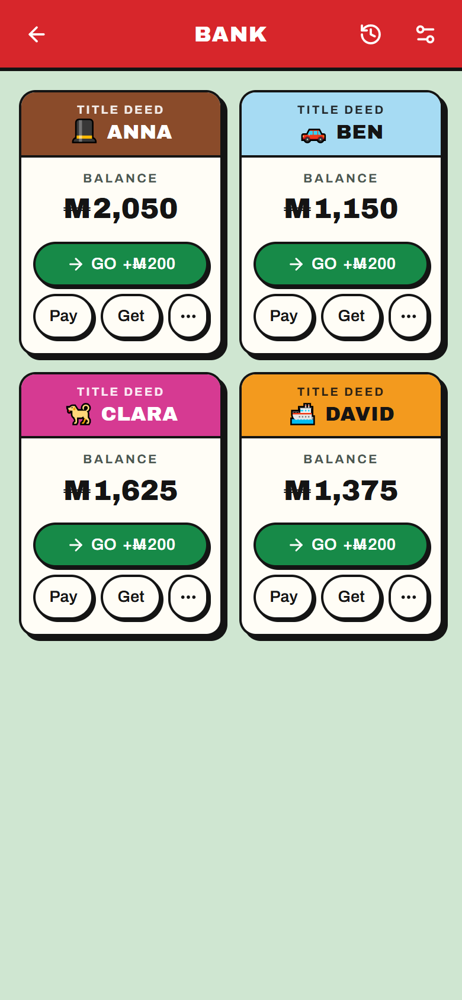
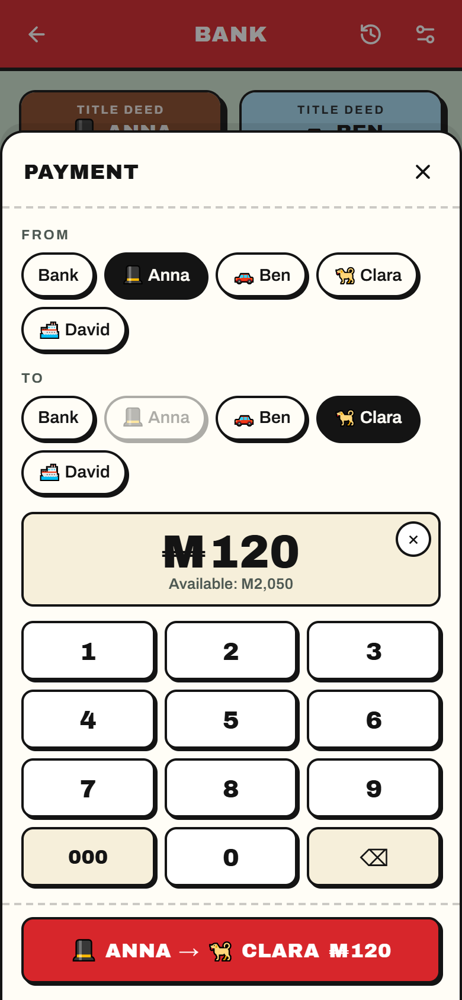
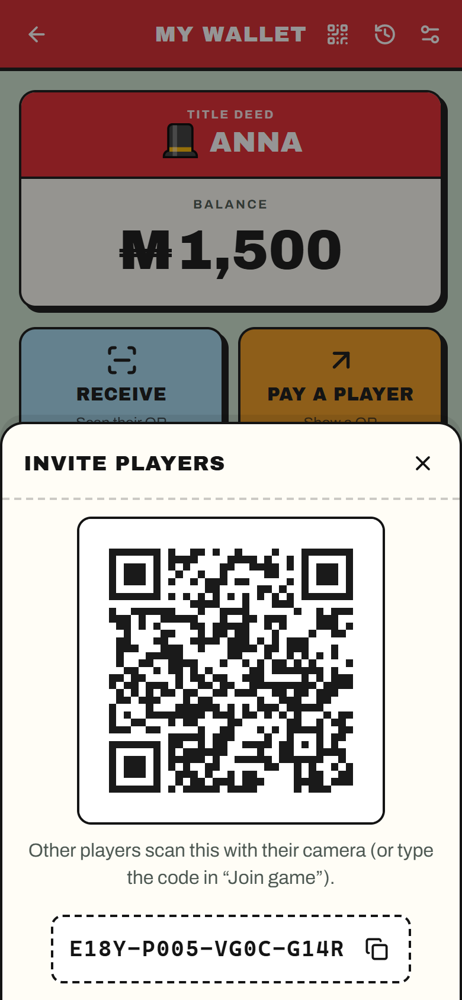

# Monopoly Bank

[](https://monopoly.iliev.cz)

**▶ Live app: [monopoly.iliev.cz](https://monopoly.iliev.cz)**: open it on your phone and tap *Add to Home Screen*.

Offline banking app for board game nights: no more paper money. Blazor WebAssembly PWA (.NET 10), installable, works without internet, no backend.

- **One shared bank** – one device holds every player's balance.
- **Wallet per player** – each phone is a wallet; pay each other via QR codes (or typed codes), no server needed.
- **Any edition** – pick or define currency, starting money and GO salary.
- Languages: English, Čeština, Deutsch, Español (add one by dropping a JSON file).

| Home | Shared bank | Payment | Wallet invite |
|:---:|:---:|:---:|:---:|
|  |  |  |  |

```
dotnet run --project src/MonopolyBank --launch-profile http   # http://localhost:5203
dotnet test
```

Every push to `main` deploys to GitHub Pages (`.github/workflows/pages.yml`).

Docs: [User guide](docs/public/README.md) · [Private / operations](docs/private/README.md) · [AI notes](CLAUDE.md)
